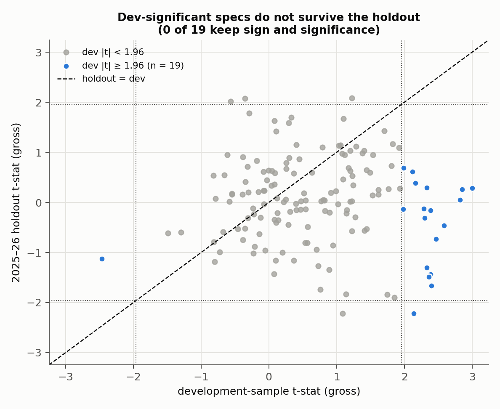
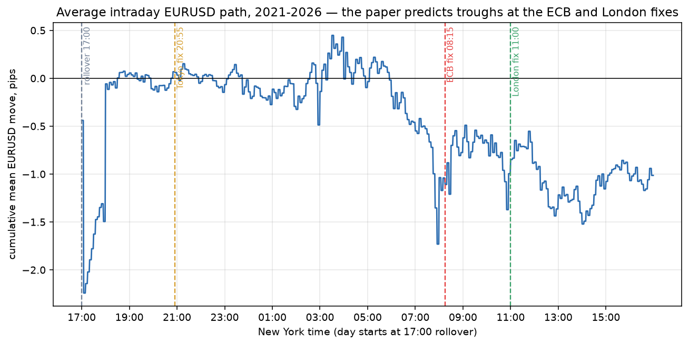
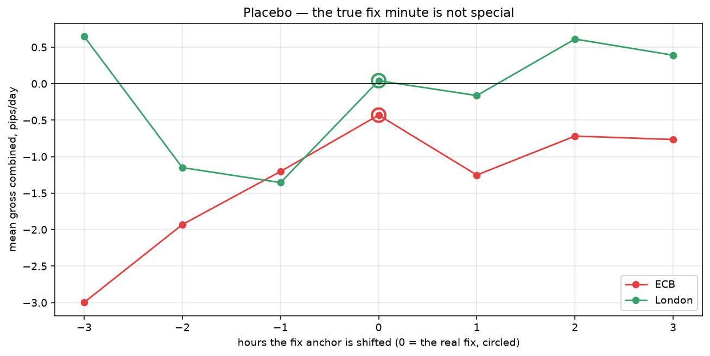
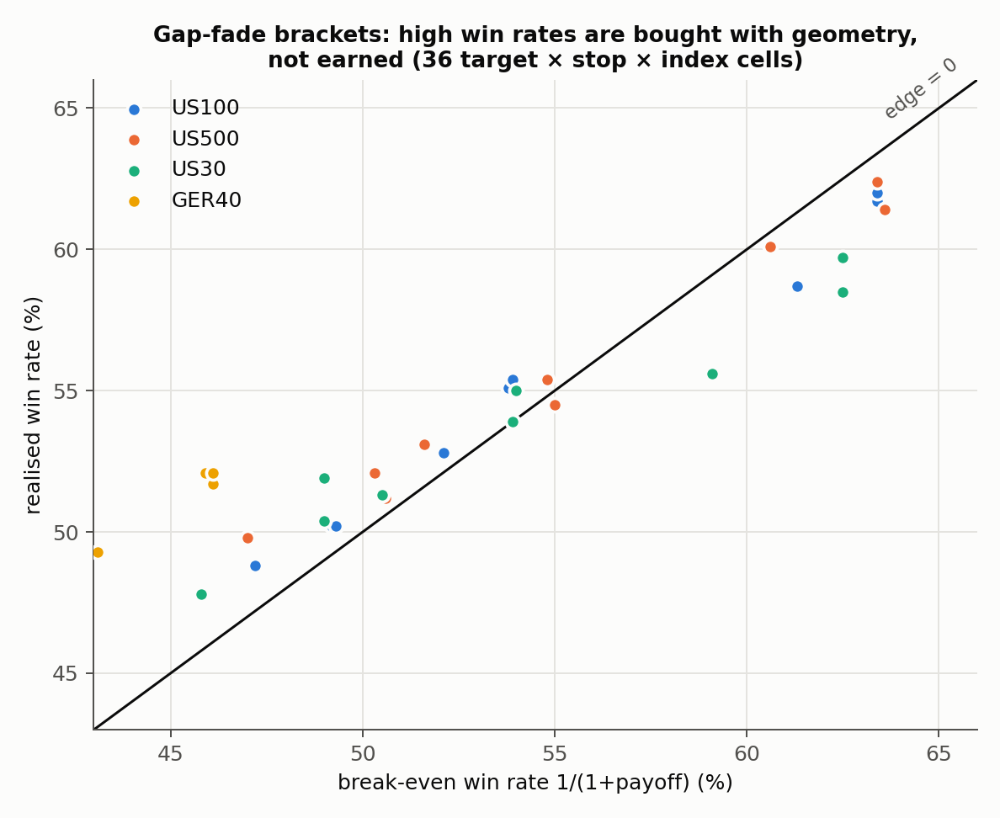
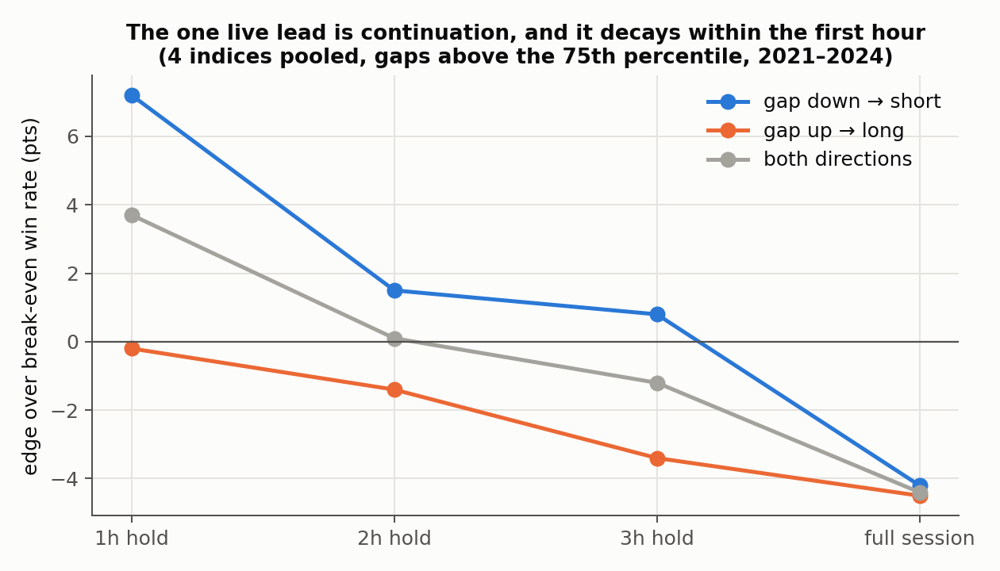
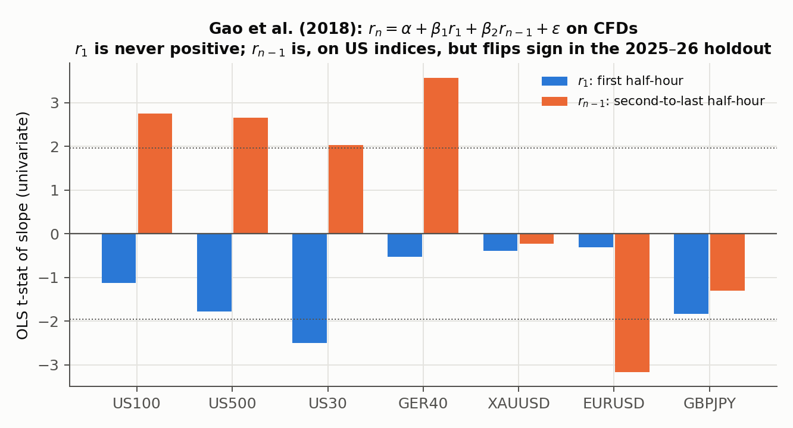
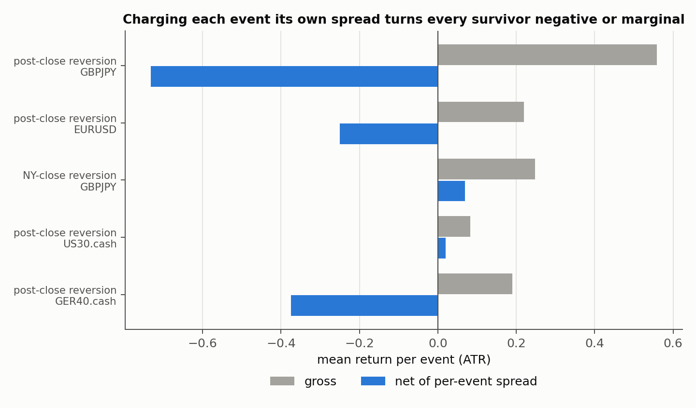

# Replicating Published Intraday Anomalies Under Realistic Costs

**Three effects documented in peer-reviewed and working-paper finance research, re-tested out of sample on a different asset class (retail CFDs on indices, FX and gold), with every trade charged the spread actually quoted at that moment.**

| # | Paper | Claim | Result here |
|---|---|---|---|
| 01 | Krohn, Mueller & Whelan (2024), *Journal of Finance* 79(6) | USD rises into the major FX fixes and falls after them | **Falsified.** Gross P&L is zero (−0.43 pips/day, t = −0.31) against the paper's ≈ +6 pips/day. Net of spread it is significantly negative. |
| 02 | Della Corte, Kosowski, Liu & Wang (2022), *Overnight–Intraday Reversal Everywhere* | The overnight return negatively predicts the next intraday return | **Sign replicates, economics do not.** Correlation is −0.05 to −0.08 on all four indices, but it lives at a ~49% win rate, and the cross-sectional version fails for lack of dispersion. |
| 03 | Gao, Han, Li & Zhou (2018), *Journal of Financial Economics* 129(2) | The first half-hour return predicts the last half-hour | **Does not replicate.** $\beta_1$ is negative on all 7 instruments (t from −2.50 to −0.31). Of 19 displacement specs significant in development, **0** survive the 2025–26 holdout. |

The value of this repository is the **process**: decode the paper exactly, check that the data can support the test, cost each trade realistically, then try hard to break the result with placebos, holdouts and per-year splits.



---

## 01 · FX fixing reversal (EURUSD, 1,170 days, 2021–2026)

The paper's Section V legs, implemented in New York time: short EURUSD from 02:00 into the fix (ECB 08:15 or London 11:00), then long until 17:00. With mid prices $m_k$ at the three boundaries:

$$g_t = 10^{4}\left[(m_{0}-m_{1}) + (m_{2}-m_{1})\right] \ \text{pips}, \qquad t = \frac{\bar g}{s_g/\sqrt{n}}$$

| | Gross, pips/day | t | Net of per-event spread | t |
|---|---:|---:|---:|---:|
| ECB fix | −0.43 | −0.31 | −2.87 | −2.07 |
| London fix | +0.04 | +0.03 | −2.40 | −1.76 |

**Three independent checks all fail:**
* per-year signs are random, and no year reaches |t| > 1.4;
* the paper's conditional mechanism has correlation −0.01;
* moving the fix anchor ±1 to 3 hours (a placebo) does as well as or *better* than the true fix minute.

**Cost finding.** Spread at the fix bar is bimodal (median 0.40, mean 1.65, p90 10.0 pips), so median-spread costing understates the true cost by about 3×. The paper's 17:00 exit lands exactly on the daily rollover, the most expensive minute of the day to trade.

<p float="left">
  
  
</p>

## 02 · Overnight–intraday reversal (US100, US500, US30, GER40)

The reversal *sign* holds on every index: $\mathrm{corr}(r^{\text{overnight}}_t,\ r^{\text{intraday}}_t)$ ranges from −0.053 to −0.079. Turning it into a trade runs into a geometry trap. For a bracket with payoff ratio $\rho = \overline{\text{win}}/\overline{|\text{loss}|}$, the break-even win rate is

$$\text{WR}_0 = \frac{1}{1+\rho}, \qquad \text{edge} = \text{WR} - \text{WR}_0 \;\;\Longleftrightarrow\;\; \mathbb{E}[\text{P\&L}] > 0 \iff \text{edge} > 0$$

so a high win rate can be bought with a near target and a far stop, without any information. Every bracket that lifts the gap-fade to a 60% win rate has *negative* edge:

<p float="left">
  
  
</p>

The only live lead points the *other* way: continuation after large down-gaps, +7.2 points of edge at 1 hour, decaying to −4.2 by the close. Pooling four ~95%-correlated indices inflates the naive t = 2.30, and a fair estimate is t ≈ 1.3–1.5. It is recorded as a lead, not a finding.

## 03 · Displacement and Gao et al. intraday momentum (7 instruments, M15, 2021–2026)

**Gao et al. regression,** estimated per instrument:

$$r_{n,t} = \alpha + \beta_1\, r_{1,t} + \beta_2\, r_{n-1,t} + \varepsilon_t$$



**Displacement study.** Ten displacement variables × six horizons × six liquidity windows, each graded with Newey–West t-statistics (lag $L$ = holding horizon, to account for overlapping returns):

$$t_{NW} = \frac{\bar x}{\sqrt{\hat\sigma^2_{NW}/n}}, \qquad \hat\sigma^2_{NW} = \hat\gamma_0 + 2\sum_{\ell=1}^{L}\left(1-\frac{\ell}{L+1}\right)\hat\gamma_\ell$$

followed by a stratified placebo (displacement reshuffled within month × half-hour, so seasonality is preserved), a per-year sign check, a mirror control and a sealed **2025–26 holdout**.

| Stage | Finding | Why it fails |
|---|---|---|
| Unconditional | reversion at 1–2 bars, continuation at 16–32 | 0.01–0.07 ATR, an order of magnitude under cost |
| NY open, indices | continuation, US100 +0.25 ATR gross, t = 2.08, placebo p = 0.013, all 6 years positive | collapses or flips sign in the holdout |
| Post-close, FX | reversion, GBPJPY +0.56 ATR gross, t = 13.7 | the per-event spread averages 1.29 ATR, so net is −0.73 ATR (t = −14.1) |
| Della Corte cross-section | close-to-open reversal | **structurally unavailable**: a 24/5 CFD has no market closure, and the overnight leg carries ~0% of daily variance (US100: 28 bp overnight vs 137 bp intraday) |



**Bar-boundary bug, caught and documented.** An early run showed a strong late-session reversal on all seven symbols (holdout t from −2.0 to −6.3). It was produced entirely by including the bar stamped 16:00, which covers 16:00–16:15 and pulls post-close prices into the "last half-hour". With the filter `ny_minute < 16*60` the effect vanishes and the sign flips.

---

## Data-integrity work

Several pipeline faults were found and fixed before any result was trusted:
* **Clock:** broker timestamps are EET/EEST wall-clock time. A fixed-offset UTC conversion is wrong for about 4 weeks a year, so everything is converted through the tz database.
* **Contract specs:** the broker's spec CSV has an unquoted comma in a description field, which shifts every later column. Point sizes are asserted from price precision instead of being read from it.
* **History resolution:** "M15" files are coarser in deep history, so the degraded head is trimmed automatically (`dataio.trim_to_resolution`).
* **Costs:** each event is charged the spread on its own signal bar, never the sample median.

## Honest notes on scope
* Study 02's first three sections use the full 2021–2026 sample. Only sections 4–5 were restricted to 2021–2024, as stated at the top of its `FINDINGS.md`.
* All data is CFD data from one retail broker, with tick volume only. The papers use futures, interbank FX or firm quotes, so a failed replication here says the effect does not *transfer* to this market. It does not say the paper is wrong.

## Repository layout

```
01-fx-fixing-reversal/
  fixstudy.py            legs, costs, per-year, conditional test, placebo anchors
  fixstudy_cells.py      figure cells (writes figs/)
  results/               per-day leg P&L (legs_*.csv) and the console log
03-displacement-and-intraday-momentum/
  src/dataio.py          loading, resolution trimming, server/UTC/NY clocks
  src/features.py        displacement variables and forward returns (ATR units)
  src/study.py           stage 1: decile tables, Newey–West, placebo
  src/stage2..6.py       liquidity windows, cost audit, Gao, Della Corte, per-event costing
  results/               every stage's output table and console log
02-overnight-intraday-reversal/
  scripts/               reversal, gap-fill brackets, conditioning, continuation
  results/logs/          console output of every script
figures/make_figures.py  builds the 02/03 figures from saved results (no broker data needed)
notebooks/walkthrough.ipynb   executed walkthrough of all three studies
```

Each study folder has a `FINDINGS.md` with the full write-up.

## Reproducing

```bash
pip install -r requirements.txt
python figures/make_figures.py
jupyter notebook notebooks/walkthrough.ipynb
```

From raw bars (format in [`data/README.md`](data/README.md)):

```bash
export BROKER_DATA_DIR=/path/to/mt5/export
python 01-fx-fixing-reversal/fixstudy.py
(cd 02-overnight-intraday-reversal/scripts && for s in reversal_research gapfill_research conditioning_research continuation_check; do python $s.py; done)
(cd 03-displacement-and-intraday-momentum && for s in study stage2 stage3 stage4 stage5 stage6; do python src/$s.py; done)
```

All three studies were re-run from a clean copy of this repository. Studies 01 and 03 reproduce their saved outputs byte-for-byte.

## References
* Krohn, I., Mueller, P., & Whelan, P. (2024). Foreign exchange fixings and returns around the clock. *The Journal of Finance*, 79(6).
* Della Corte, P., Kosowski, R., Liu, S., & Wang, T. (2022). Overnight–intraday reversal everywhere. Working paper.
* Gao, L., Han, Y., Li, S. Z., & Zhou, G. (2018). Market intraday momentum. *Journal of Financial Economics*, 129(2), 394–414.

---
*Author: Muhammad Talal Malik · Business Data Analytics, COMSATS University*
